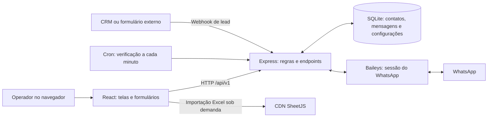
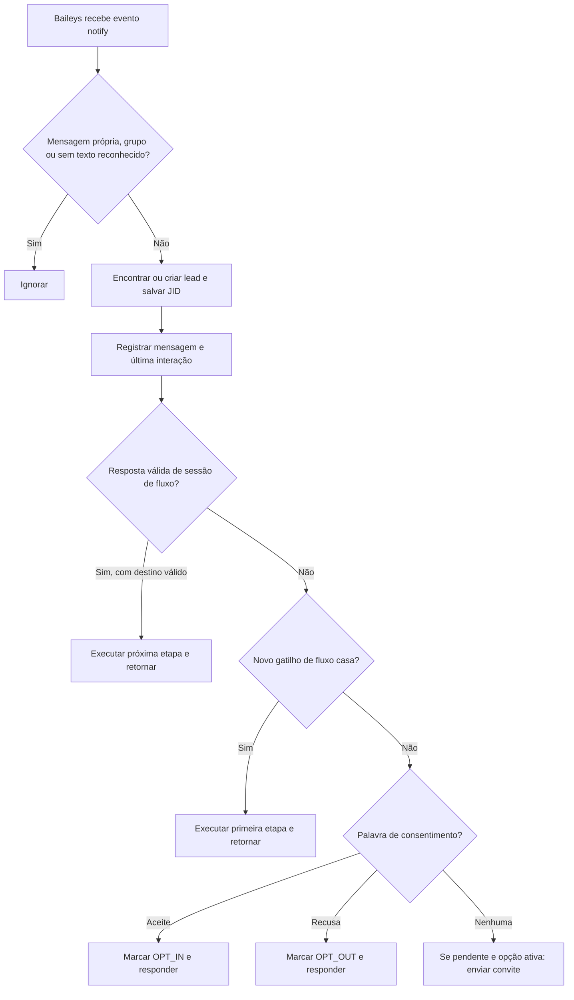

# Relatório completo do projeto WappGR

> **Retrato histórico anterior às alterações.** A implementação posterior e as evidências de 16/10/2026 estão em [Implementação e validação](IMPLEMENTACAO_E_VALIDACAO.md). As limitações descritas abaixo se referem à análise original.

**Data da análise:** 15 de outubro de 2026  
**Projeto analisado:** `C:\xampp\htdocs\WappGR`  
**Versão declarada:** `1.0.0`  
**Escopo:** funcionalidades, interface, servidor, banco de dados, integrações, configuração, execução, limitações e problemas encontrados.

**Navegação:** [Visão geral](#1-visão-geral) · [Arquitetura](#2-como-as-partes-se-conectam) · [Funcionalidades](#3-funcionalidades-tela-por-tela) · [Banco de dados](#5-modelo-de-dados) · [API](#6-catálogo-completo-da-api) · [Arquivos](#8-arquivos-e-responsabilidade) · [Execução](#10-execução-e-configuração-previstas) · [Estado dos recursos](#11-estado-de-implementação-por-capacidade) · [Problemas](#12-problemas-de-maior-impacto) · [Validação](#16-validação-realizada-e-limites) · [Correções](#17-sequência-recomendada-de-correções).

## 1. Visão geral

O **WappGR é uma aplicação web de gestão de contatos e automação de mensagens para WhatsApp**. Ela reúne uma base de leads, classificação de consentimento, campanhas de envio em massa, agendamentos recorrentes, atendimento individual e fluxos de conversação com opções de resposta e mídia.

O objetivo comercial aparente é permitir que uma operação de vendas ou relacionamento importe contatos, organize públicos, envie ofertas, responda interessados automaticamente e receba leads de formulários ou de sistemas externos.

A arquitetura efetivamente utilizada é **React no navegador, Node.js com Express no servidor, SQLite como banco e Baileys como conexão com o WhatsApp**. O projeto também contém um cliente Evolution API e um Docker Compose para esse serviço, mas eles não fazem parte do caminho de execução do servidor atual.

Existem implementações reais de envio e recebimento; o projeto não se limita a telas demonstrativas. Entretanto, a análise encontrou falhas de segurança, consentimento, consistência dos registros e continuidade das automações. **A implementação atual precisa de correções antes de ser tratada como uma plataforma de produção confiável**, especialmente se ficar acessível pela internet.

As expressões “Anti-Ban”, “Meta Policy Compliant”, “mensagens entregues sem ban” e a taxa de entrega de “99.4%” aparecem na interface. Elas **não são garantias demonstradas pelo código**. O que o código implementa é seleção de contatos por status em determinados envios e intervalos aleatórios entre mensagens. Este relatório avalia a implementação, sem emitir certificação de conformidade com regras externas.

### 1.1 O que foi analisado e como interpretar os resultados

Foram examinados:

- Os **33 arquivos versionados** existentes antes da criação deste relatório.
- Os **20 arquivos JavaScript, JSX e CSS**, com aproximadamente **8.283 linhas físicas**, incluindo comentários e linhas em branco.
- As **nove áreas de navegação** da aplicação.
- Os **43 registros de rotas** do servidor Express.
- O esquema de banco definido pelo código e o banco SQLite existente, aberto em modo somente leitura.
- Os dados estruturais do JSON legado, sem reproduzir informações pessoais ou chaves.
- O manifesto de dependências, o arquivo de versões travadas, o Vite, o Docker Compose e a documentação existente.
- Verificações de sintaxe e ensaios isolados de regras de negócio.

Neste documento, **“implementado” significa que existe código que realiza a operação**. Isso não significa que a operação tenha sido validada com uma conta real de WhatsApp.

Não foram enviados recados ou campanhas reais, pareadas contas, acionados serviços Docker ou executado o servidor sobre o banco existente. Os ensaios de regras usaram SQLite em memória e substitutos locais para Express, cron e WhatsApp. As limitações dessa validação estão detalhadas na seção 16.

## 2. Como as partes se conectam

### 2.1 Interface

O navegador carrega uma aplicação React de página única. A navegação usa a variável `activeTab` de `src/App.jsx`. Não há biblioteca de rotas, URLs independentes por módulo nem mecanismo implementado de autenticação do operador.

O estado central contém estatísticas, leads, categorias, fluxos, regras de opt-in, campanhas, agendamentos, mensagens, conexão e configurações de CRM.

O carregamento geral faz dez requisições em paralelo. Repete essa atualização a cada **oito segundos** e também depois de muitas ações. Portanto, o chamado “chat em tempo real” usa consultas periódicas no navegador; não existe WebSocket entre esse navegador e o servidor.

Há avisos temporários de sucesso, erro, informação e alerta, com duração de aproximadamente quatro segundos.

### 2.2 Servidor

`server/index.js` concentra:

- A configuração do Express.
- Os callbacks de mensagens e conexão do WhatsApp.
- O motor de fluxos.
- As rotas de todos os módulos.
- O processamento das campanhas.
- O agendador cron.
- A entrega do frontend compilado, quando existe `dist/`.

O servidor aceita JSON de até **10 MB** e habilita `cors()` sem restrição explícita de origem.

As operações de banco usam SQL preparado com parâmetros na maior parte das consultas. Importações e algumas operações em lote usam transações.

### 2.3 Persistência

Os dados operacionais ficam em `server/wappgr.db`. As credenciais de pareamento do WhatsApp são gravadas separadamente em `server/baileys_auth/` quando a conexão é inicializada.

A aplicação trabalha, na prática, com **uma base compartilhada e uma sessão principal de WhatsApp**. Não há separação implementada por empresa, usuário ou conta atendente.

### 2.4 Serviços que são e que não são necessários

Para o caminho atual, são necessários Node.js, as dependências npm, acesso ao WhatsApp e um navegador. **PHP, MySQL, Apache e o painel XAMPP não participam do código analisado**, apesar de a pasta estar dentro de `xampp/htdocs`.

O PostgreSQL do Docker Compose é destinado à Evolution API. O banco principal do WappGR continua sendo SQLite.

**Referências:** `src/App.jsx:39`, `src/App.jsx:74`, `server/index.js:1`, `server/db.js:5` e `vite.config.js`.

## 3. Funcionalidades, tela por tela

### 3.1 Dashboard

O painel inicial mostra:

- Total de leads cadastrados.
- Quantidade de leads com opt-in.
- Quantidade de leads com opt-out.
- Percentual de opt-in em relação à base inteira.
- Total de envios contabilizados nas campanhas.
- Quantidade de agendamentos ativos.
- Gráfico circular de consentimento.
- Gráfico de mensagens enviadas e recebidas em uma janela dos últimos sete dias.
- As 15 mensagens mais recentes.
- Atalhos para leads, campanhas, opt-in e chat.
- Informações de conexão recebidas pela aplicação.

O percentual de aceite é calculado no servidor:

`percentual = arredondar(leads OPT_IN / total de leads × 100)`.

O gráfico de volume conta registros da tabela `messages` por direção. Isso inclui respostas automáticas, chat, fluxos e registros de falha classificados como saída. Ele não equivale a um relatório de entregas confirmadas pelo destinatário.

O indicador “total envio em massa” soma `campaigns.sent_count`. Envios agendados e conversas individuais não são somados diretamente nesse indicador.

**Limitações encontradas:**

- A taxa de entrega **99,4% é fixa na interface**.
- A legenda de cadência “10s–15s aleatório” também é fixa e pode divergir da campanha.
- O feed usa `leadName` e `leadPhone`, mas o endpoint retorna `lead_name` e `lead_phone`. Os nomes e telefones podem ficar ausentes nesse trecho.
- Dias sem mensagens não são preenchidos com zero na consulta.
- Os cartões de opt-in e opt-out abrem a tela de leads, mas não aplicam automaticamente o filtro correspondente.
- Não há métricas implementadas de vendas, receita, conversão comercial, bloqueios reais ou leitura pelo destinatário.

**Referências:** `src/components/Dashboard.jsx`; `server/index.js:228`.

### 3.2 Conectar WhatsApp

A tela oferece:

- Iniciar o pareamento.
- Exibir QR Code.
- Consultar o estado da conexão.
- Mostrar número e nome do perfil conectado.
- Desconectar a sessão.
- Instruções de pareamento pelo celular.

Os estados usados são `DISCONNECTED`, `PAIRING` e `CONNECTED`.

O Baileys guarda credenciais em arquivos locais. Quando a conexão cai por motivo diferente de logout, há tentativa de reconexão após aproximadamente três segundos. Em caso de logout, a pasta de autenticação é removida.

Um detalhe operacional relevante: **o servidor chama `baileys.init()` ao iniciar, mesmo sem credenciais existentes**. Apesar de um comentário sugerir inicialização apenas se houver autenticação, o código não faz essa condição. Ele pode começar a gerar o QR Code logo na inicialização.

A leitura do QR Code na tela é feita indiretamente pelo endpoint de status. Existe um endpoint específico de QR Code e um callback correspondente no App, mas esse callback não é usado pelo componente atual.

**Limitações encontradas:**

- Existe apenas um gerenciador de sessão em memória.
- Não há gestão de vários números.
- Não há integração ativa com Meta Cloud API.
- Repetir a inicialização não encerra explicitamente um socket anterior; a trava existente cobre apenas o período de inicialização.
- `baileysAlive: true` no endpoint de status é um valor fixo, não um teste independente de saúde.
- Há um encadeamento de efeitos React que pode gerar consultas contínuas: o callback de status muda a cada renderização, o efeito da tela depende dele e a consulta atualiza novamente o estado central. Isso exige confirmação visual após instalar as dependências, mas o encadeamento está presente no código.
- A pasta de autenticação não está explicitamente excluída pelo `.gitignore`.

**Referências:** `src/components/ConnectionManager.jsx:21`; `src/App.jsx:432`; `server/baileys.js:39`; `server/index.js:222` e `server/index.js:1276`.

### 3.3 Gestão de leads

Cada lead reúne:

| Informação | Uso |
|---|---|
| ID | Identificador interno UUID |
| Nome | Identificação e personalização das mensagens |
| Telefone | Busca, deduplicação e envio |
| JID | Endereço interno utilizado pelo WhatsApp |
| Categoria | Segmentação do contato |
| Status | `OPT_IN`, `OPT_OUT` ou `PENDING` |
| Método de consentimento | Origem da classificação atual |
| Data de consentimento | Momento registrado da classificação |
| Observações | Notas internas e informações da importação |
| Contador de envios | Contagem atualizada por alguns mecanismos de envio |
| Última interação | Data da última atividade registrada |
| Data de cadastro | Momento de criação |

A interface permite:

- Cadastrar um lead.
- Editar nome, categoria, status e observações.
- Trocar a categoria diretamente na tabela.
- Aprovar opt-in ou marcar opt-out por ação rápida.
- Excluir um contato com confirmação visual.
- Buscar por nome, telefone ou observações.
- Filtrar por categoria e consentimento.
- Selecionar contatos individualmente ou todos os filtrados.
- Alterar categoria e consentimento em lote.
- Excluir ou exportar os selecionados.
- Paginar a tabela em 50, 100, 250, 500, 1.000 registros ou todos os carregados.

O telefone não pode ser editado pelo formulário atual. No servidor, a atualização individual também não implementa alteração de telefone.

#### Regras de cadastro e deduplicação

No cadastro manual e na importação, caracteres não numéricos são removidos. Em determinados números com dez ou onze dígitos, o código acrescenta o DDI `55`.

O telefone tem restrição de unicidade. O cadastro manual duplicado retorna HTTP `409`.

Categorias informadas por nome podem ser criadas automaticamente em cadastro, atualização e importação.

A API de cadastro usa `PENDING` quando não recebe uma escolha válida de consentimento. **A interface, entretanto, inicia o formulário com `OPT_IN` selecionado.**

Cadastrar individualmente um contato pendente pode disparar a mensagem de boas-vindas, se a opção automática estiver ativa.

#### Limites e diferenças relevantes

- O App busca os **10.000 leads mais recentes**. A paginação da tela ocorre dentro desse conjunto.
- A API suporta páginas e até 100.000 registros por requisição, mas a tela não utiliza essa paginação remota.
- Em bases maiores, a tela, a contagem de audiência de campanhas e a seleção de todos podem representar apenas o conjunto carregado.
- O servidor calcula os destinatários de uma campanha na base inteira. Assim, pode enviar para mais contatos que a prévia da tela indica.
- A normalização falha para certos números nacionais cujo DDD é `55`: considera o início `55` como se já fosse DDI e não acrescenta o código do país.
- Captura pelo WhatsApp, simulador e webhook não usam exatamente a mesma normalização do cadastro.
- Um identificador `@lid` recebido pode ser armazenado na coluna telefone como se fosse número telefônico; o código preserva o JID, mas não resolve de forma completa a identidade telefônica.
- A exclusão do lead **preserva mensagens e seus campos de nome e telefone**; o vínculo `lead_id` vira nulo.
- As sessões de fluxo não têm chave estrangeira para a tabela de leads, podendo permanecer após excluir o contato.

**Referências:** `src/components/LeadsManager.jsx:193`; `server/index.js:280`, `server/index.js:327` e `server/index.js:718`.

### 3.4 Categorias

As categorias possuem nome, cor, descrição, data de criação e contagem de contatos associados.

Recursos disponíveis:

- Criar, renomear e editar cor e descrição.
- Excluir individualmente.
- Excluir várias de uma vez.
- Buscar categorias por nome.
- Selecionar categorias vazias.
- Remover todas as categorias sem leads.
- Reparar categorias consideradas corrompidas.
- Criar categorias automaticamente durante determinadas operações.

Excluir uma categoria individualmente deixa os contatos sem categoria. A API de exclusão em lote também aceita `reassignTo`, permitindo transferir os contatos para um ID de categoria existente. A tela de exclusão em lote não utiliza essa opção; deixa-os sem categoria.

O reparo considera suspeitos nomes vazios, compostos apenas de determinados símbolos, com caracteres de controle ou substituição, resíduos como `xml` e `xl/`, ou mais de 45 caracteres. Os contatos são movidos para “Leads Orgânicos” antes da exclusão da categoria.

**Esse reparo também roda automaticamente ao iniciar o servidor.**

Isso pode alterar categorias legítimas que se encaixem nas heurísticas, por exemplo nomes longos. Além disso, uma categoria vazia pode continuar sendo referenciada por nome em um fluxo ou agendamento, algo que a limpeza não verifica.

A interface pode mostrar “Leads Orgânicos” como fallback para contatos sem categoria, mesmo que no banco não exista esse vínculo. Há diferença entre apresentação e classificação persistida.

**Referências:** `server/index.js:796`, `server/index.js:872`, `server/index.js:891` e `server/index.js:1588`.

### 3.5 Importação de contatos

O projeto possui um importador próprio de texto com:

- Upload de CSV ou TXT pela interface.
- Colagem de dados de planilhas.
- Detecção de separador por tabulação, ponto e vírgula, barra vertical ou vírgula.
- Identificação de cabeçalhos por nomes e aproximações.
- Prévia dos primeiros cinco contatos.
- Escolha de consentimento para o lote inteiro.
- Categoria fixa, nova categoria ou categoria derivada da planilha.
- Opção de atualizar contatos existentes.
- Contagem final de novos, atualizados e ignorados.

Entre as colunas reconhecidas estão:

| Coluna de origem | Tratamento |
|---|---|
| Contato, Nome, Name, Cliente | Nome do lead |
| Telefone, Celular, Phone e semelhantes | Telefone |
| Desde, Cadastro, Criado | Data de cadastro na inserção |
| Etiquetas, Tag, Categoria, Grupo | Categoria, se habilitado |
| Último Envio e semelhantes | Última interação |
| Observações, Notas, Descrição | Notas |
| Ação Rápida | Ignorada |

Quando há várias etiquetas, apenas a primeira candidata é usada como categoria. O conteúdo completo das etiquetas e algumas datas também são preservados em observações.

Sem cabeçalho, o parser tenta inferir nome e telefone pela posição e pela quantidade de dígitos. Na interface, registros com menos de oito dígitos de telefone são descartados. O servidor faz validação mais permissiva na importação: verifica principalmente se restou algum número e se existe nome.

A gravação do lote usa transação e deduplicação por telefone. A interface inicia com **opt-in selecionado e atualização de existentes habilitada**. A API, isoladamente, usa `updateExisting = false` quando o parâmetro não é fornecido.

#### Suporte a Excel

Há código para ler `.xlsx` e `.xls` usando SheetJS carregado sob demanda de um CDN. Ele lê apenas a primeira aba e converte para texto separado por tabulações.

Entretanto, o seletor da tela declara apenas `accept=".csv,.txt"`, e os rótulos apresentam CSV/TXT. Portanto, o suporte a Excel existe no handler, mas não está plenamente exposto pela interface. Não deve ser descrito como uma experiência completa de importação Excel.

#### Problemas confirmados

- Uma entrada simples separada por `|` excedeu o limite de 300 ms no ensaio isolado. O separador não é escapado na expressão regular, permitindo uma repetição sem avanço que pode travar a interface.
- A divisão prévia por linhas impede um tratamento completo de campos CSV com quebras de linha dentro de aspas.
- O parser não importa o status individual do CSV: a classificação escolhida para o lote prevalece.
- Na reimportação do CSV exportado pelo próprio sistema, um contato `OPT_OUT` pode virar `OPT_IN` com as escolhas padrão.
- A coluna “Envios Realizados” do exportador pode ser interpretada como “Último Envio”, misturando contagem com data.
- Contatos importados como pendentes **não recebem imediatamente a mensagem automática prometida pelo texto da tela**. O endpoint de importação não faz esse envio.
- Ao ativar categorias da planilha depois de carregar um arquivo, o reprocessamento completo só existe para texto colado; os dados do arquivo não são relidos automaticamente.
- O teste de arquivo binário também rejeita texto com o caractere de substituição Unicode, podendo barrar CSV com problema de codificação.

**Referências:** `src/components/LeadsManager.jsx:37`, `src/components/LeadsManager.jsx:403`, `src/components/LeadsManager.jsx:490` e `src/components/LeadsManager.jsx:1785`; `server/index.js:579`.

### 3.6 Exportação de contatos

A exportação gera um arquivo CSV com:

- Separador `;`.
- Codificação UTF-8 com BOM.
- Valores entre aspas.
- Aspas internas duplicadas.
- Quebras de linha CRLF.
- Nome no formato `leads_wappgr_AAAA-MM-DD.csv`.

As dez colunas são:

1. ID.
2. Nome.
3. Telefone.
4. Categoria.
5. Status de consentimento.
6. Método de consentimento.
7. Data de consentimento.
8. Envios realizados.
9. Observações.
10. Data de cadastro.

É possível exportar todos os leads, os resultados dos filtros ou IDs selecionados. O servidor busca os resultados diretamente no banco; a exportação total não está limitada aos 10.000 contatos carregados na tela.

O arquivo é CSV, não uma pasta de trabalho Excel nativa. Também não é um backup completo: não inclui todas as tabelas, credenciais, JID, histórico integral nem as automações.

O escape de CSV não neutraliza valores que uma planilha interprete como fórmula. Esse é um ponto de endurecimento para dados vindos de fontes externas.

**Referências:** `server/index.js:432`, `server/index.js:475` e `server/index.js:512`.

### 3.7 Regras de opt-in e opt-out

O módulo configura:

- Solicitação automática de permissão.
- Texto de boas-vindas.
- Texto de confirmação.
- Texto de cancelamento.
- Palavras de aceite.
- Palavras de recusa.

Os estados são:

| Estado | Significado operacional |
|---|---|
| `PENDING` | Ainda não classificado como autorizado para campanhas |
| `OPT_IN` | Elegível para seleção em campanhas e agendamentos |
| `OPT_OUT` | Excluído da seleção inicial de campanhas e agendamentos |

As palavras são comparadas após remover espaços das extremidades e converter para maiúsculas. O aceite/recusa exige correspondência exata nessa etapa.

A configuração inicial do banco inclui palavras de aceite como `SIM`, `QUERO`, `1`, `ACEITO` e `SIM!`; e de recusa como `SAIR`, `PARAR`, `CANCELAR`, `2`, `NÃO` e `NAO`.

Apesar do nome `autoOptInOnFirstMessage`, essa opção não aprova automaticamente o contato por ele iniciar uma conversa. Ela envia o convite ao consentimento se o contato estiver pendente.

O convite pode se repetir em mensagens posteriores enquanto o contato continuar pendente; não há uma flag separada de “convite já enviado”.

#### Origem do consentimento

O código grava métodos como:

- `NONE`.
- `MANUAL`.
- `MANUAL_OVERRIDE`.
- `MANUAL_BULK_OVERRIDE`.
- `IMPORT`.
- `IMPORT_OPT_IN`.
- `IMPORT_OPT_OUT`.
- `WHATSAPP_KEYWORD`.
- `OPT_OUT_REQUESTED`.
- `FORM_WEBHOOK`.

Esses registros descrevem a classificação atual. Não existe uma tabela de auditoria imutável com todas as transições, operador responsável, texto autorizado e versões das regras.

A tabela visual de leads não traduz todos esses métodos. Alguns aparecem como “Pendente” mesmo com status diferente.

#### O simulador

A tela possui uma prévia em formato de conversa. Ao enviar uma mensagem nela, o App chama `POST /api/v1/optin/process-message`.

Esse endpoint:

1. Busca ou cria um lead.
2. Registra uma mensagem de entrada.
3. Atualiza o consentimento.
4. Atualiza a última interação.
5. Tenta enviar a resposta pelo WhatsApp.
6. Registra a saída.
7. Devolve o estado atualizado.

Portanto, **o simulador tem efeitos reais sobre a base e pode enviar uma resposta real se houver conexão**. O telefone e o nome de teste são definidos no componente e não têm campos visíveis para edição na tela atual.

Também há uma diferença de comportamento: esse endpoint processa consentimento diretamente; a mensagem recebida pelo Baileys passa antes pelo motor de fluxos. Um teste no simulador pode passar e a mesma palavra se comportar de outra forma na conversa real.

**Referências:** `src/components/OptInEngineConfig.jsx`; `server/index.js:193` e `server/index.js:1051`.

### 3.8 Campanhas de envio em massa

O formulário de campanha recebe:

- Título.
- Categoria de destino ou todas.
- Mensagem.
- Intervalo entre envios.

A interface permite escolher intervalo entre **cinco e trinta segundos**, com padrão de dez. O servidor não impõe esses mesmos limites.

A audiência é selecionada no servidor por `status = 'OPT_IN'` e, quando solicitado, pelo nome da categoria.

A mensagem permite substituir:

| Variável | Valor utilizado |
|---|---|
| `{nome}` | Nome do contato |
| `{categoria}` | Nome da categoria |
| `{telefone}` | Telefone |

A interface oferece botões para inserir nome e categoria; telefone é reconhecido pelo servidor mesmo sem botão específico.

O fluxo de execução é:

1. Validar título e mensagem.
2. Buscar os destinatários elegíveis.
3. Recusar a campanha se não houver destinatários.
4. Criar um registro `SENDING`.
5. Responder à interface que o disparo começou.
6. Percorrer os destinatários dentro do processo Node.
7. Personalizar e enviar o texto.
8. Registrar sucesso ou falha.
9. Atualizar contadores.
10. Esperar um intervalo aleatório.
11. Ao terminar, marcar `COMPLETED`.

A variação do intervalo é de **70% a 130% do valor configurado**. Com dez segundos, o atraso fica entre sete e treze segundos, além do tempo da chamada de envio.

A tela mostra o histórico de campanhas, mensagem, categoria, estado e contagem.

#### Limitações operacionais

- Campanhas enviam texto; o formulário não possui anexo ou mídia.
- Não há pausa, cancelamento, retomada ou reenvio seletivo.
- Não existe fila persistente por destinatário.
- Uma interrupção do Node pode deixar a campanha em `SENDING` sem retomada automática.
- Campanhas simultâneas têm seus próprios loops; não há um limitador global compartilhado com cron e fluxos.
- O consentimento é consultado ao montar a lista. Ele não é reconsultado imediatamente antes de cada envio.
- A aplicação permite começar uma campanha desconectada; as tentativas falham durante o processamento.
- Mesmo quando todos os envios falham, o estado final é `COMPLETED`.
- `delivered_count` recebe o número de envios que retornaram sucesso. Não depende de evento de entrega ao destinatário.
- O contador do lead é incrementado inclusive em tentativas que falharam.
- Os detalhes de falhas ficam no histórico de mensagens; a tela de campanhas não oferece um relatório completo por destinatário.

**Referências:** `src/components/CampaignBroadcastWizard.jsx`; `server/index.js:1118`.

### 3.9 Agendamento recorrente

A tela permite criar regras com:

- Título.
- Mensagem.
- Categoria.
- Horário.
- Recorrência.
- Dias da semana, quando aplicável.

As opções visíveis são:

| Recorrência | Intenção |
|---|---|
| `DAILY` | Executar diariamente |
| `EVERY_OTHER_DAY` | Executar em dias alternados |
| `SPECIFIC_DAYS` | Executar nos dias selecionados |

As regras podem ser ativadas, desativadas e excluídas. Não há edição completa de uma regra existente pela interface ou por uma rota de atualização geral.

O cron roda a cada minuto. Ele compara o horário local do processo com `time_of_day`, verifica a recorrência e seleciona os contatos `OPT_IN`.

A mensagem agendada substitui `{nome}` e `{categoria}`. Diferentemente da campanha, esse trecho não substitui `{telefone}`.

O formulário mantém `pacingSeconds: 10`, mas não fornece controle para alterar esse valor. A API aceita o parâmetro.

#### Limitações e falhas

- O processo precisa estar funcionando no minuto exato. Não há recuperação de execuções perdidas enquanto o servidor estava desligado.
- Não há fuso explicitamente configurado no cron.
- `last_run_at` é gravado pelo SQLite em UTC, sem indicação de fuso na string, e depois lido com `new Date(...)`. A mistura com horário local pode distorcer os cálculos.
- A execução em dias alternados usa 48 horas completas desde o término anterior. O tempo gasto no envio pode fazer a regra pular o dia esperado.
- O tipo `ONCE` é aceito pelo banco e pela API, mas não tem lógica de desativação após rodar. Não aparece como opção na tela.
- `next_run_at` existe no esquema, mas não é calculado.
- O consentimento também não é revalidado para cada destinatário durante o lote.
- Pausar ou excluir uma regra não cancela um lote já carregado na memória.
- O código não verifica `result.success` no envio agendado. Uma resposta de falha do Baileys pode virar registro de envio `SENT`.
- Não é criada uma campanha correspondente à execução do cron; por isso ela não entra no histórico de campanhas da mesma forma.
- Não existe uma trava persistente de execução para coordenar vários processos ou impedir sobreposição de trabalhos demorados.

**Referências:** `src/components/SchedulerManager.jsx`; `server/index.js:1198` e `server/index.js:1495`.

### 3.10 Chat individual

O módulo apresenta:

- Lista de contatos.
- Busca por nome e telefone.
- Nome, telefone e categoria do contato selecionado.
- Indicador de consentimento.
- Histórico em balões.
- Identificação de entrada e saída.
- Horário e tipo de registro.
- Campo para enviar texto.
- Prévia otimista da mensagem enquanto a requisição é processada.
- Rolagem automática para o final.

O envio utiliza o JID salvo, quando existe, ou o telefone. Se o envio resolver um JID, ele pode ser gravado no lead.

#### Limitações

- O App carrega **as últimas 100 mensagens da base inteira**. A tela filtra esse conjunto pelo contato.
- A API aceita buscar por `leadId` e até 500 mensagens, mas a interface não faz essa consulta ao selecionar uma conversa.
- Conversas antigas podem parecer vazias apesar de haver histórico no banco.
- O envio direto não verifica o status de consentimento; pode tentar enviar a um `OPT_OUT`.
- O histórico registra a saída mesmo quando o envio falha.
- O ícone de dois checks aparece para qualquer saída não pendente, sem vínculo com confirmação de entrega ou leitura.
- Não há upload de arquivos, captura de áudio ou envio de imagem pelo chat.
- Não há equipe de atendentes, atribuição de conversa, fila, não lidas, SLA ou transferência operacional.
- Mensagens enviadas pelo próprio telefone são ignoradas pelo listener `fromMe`; não são sincronizadas como histórico completo da conversa.
- A troca de contato enquanto há mensagem otimista pendente não possui uma separação completa desse estado por conversa.

**Referências:** `src/components/LiveChat.jsx`; `src/App.jsx:84`; `server/index.js:1233`.

### 3.11 Fluxos e funis interativos

O módulo permite criar automações compostas por etapas.

Cada fluxo tem:

- Nome.
- Descrição.
- Tipo de gatilho.
- Palavras-chave.
- Estado ativo/inativo.
- Conjunto de etapas.
- Quantidade de sessões registradas em andamento.

Cada etapa pode conter:

- ID e título.
- Tipo `TEXT`, `IMAGE`, `AUDIO` ou `VIDEO`.
- Conteúdo ou legenda.
- URL da mídia.
- Atraso.
- Mudança de categoria.
- Opções de resposta.
- Destino de cada opção.

A interface é um editor de formulários e cartões de etapas. Não há um canvas de arrastar e conectar blocos.

#### Gatilhos

O gatilho por palavras procura se a mensagem **contém** uma das palavras configuradas, ignorando diferenças de maiúsculas/minúsculas. Não há análise de linguagem natural ou IA.

O gatilho `ALL_NEW` usa a condição `messages_sent_count <= 1`. Esse contador não corresponde necessariamente a “novo contato” ou “primeira conversa”, podendo disparar em situações diferentes do rótulo da tela.

Os fluxos ativos são consultados sem uma prioridade explícita. O primeiro que casar e tiver etapas processa a mensagem e interrompe a busca.

#### Execução das etapas

O motor:

1. Personaliza o conteúdo.
2. Pode criar ou alterar a categoria do lead.
3. Espera o atraso configurado.
4. Envia texto ou mídia.
5. Registra a saída.
6. Incrementa o contador do lead.
7. Salva a etapa em que aguarda resposta, continua ou encerra.

As opções apresentadas como “botões” são enviadas pelo Baileys como **texto com números, rótulos e instrução para digitar**. Não são botões nativos interativos do WhatsApp.

A resposta pode casar com a palavra configurada, com o rótulo inteiro ou com parte do rótulo quando o texto tem ao menos três caracteres.

O servidor também entende `step.nextStepId` para continuidade automática de uma etapa sem opções. O editor atual não fornece um campo específico para configurar esse encadeamento automático; seu foco é o destino das opções.

#### Mídias

- Imagem: URL e legenda.
- Vídeo: URL e legenda.
- Áudio: URL, MIME fixo `audio/mp4` e envio como nota de voz; texto complementar vai em uma mensagem separada.
- Texto: conteúdo e lista textual de opções.
- Falha no envio de mídia: tentativa de enviar apenas o texto.

Não existe upload ou armazenamento de arquivos de mídia no WappGR. A URL precisa ser acessível ao mecanismo de envio.

O log do fluxo não preserva uma representação completa da mídia e das opções enviadas. Em áudio acompanhado de texto, também não representa de forma completa os dois envios.

#### Fluxo de exemplo

Quando a tabela de fluxos está vazia, o banco cria um exemplo ativo chamado “Funil Interativo de Vendas & Catálogo”, com:

- Menu inicial.
- Catálogo ilustrado por imagem externa.
- Caminho descrito como atendimento humano.
- Mensagem de cupom.
- Mudanças para categorias como “Interessados” e “Clientes VIP”.

A mensagem de transferência para equipe é apenas um texto. Não existe mecanismo que notifique ou atribua a conversa a um atendente. O cupom também é texto de exemplo, sem integração com catálogo, pedido ou sistema de descontos.

O exemplo é recriado na inicialização se todos os fluxos tiverem sido removidos e a tabela estiver vazia.

#### Problemas encontrados

- Fluxos têm prioridade sobre consentimento. `QUERO` pode abrir o exemplo sem registrar opt-in; `2` pode escolher “atendente” sem registrar opt-out.
- Um fluxo pode ser executado para contato pendente ou com opt-out.
- O acionamento manual não exige fluxo ativo nem conexão confirmada.
- A opção “Fim do Fluxo” salva destino vazio; o processamento da resposta só trata destinos preenchidos. A sessão pode continuar aberta.
- Não existe tempo limite de sessão nem comando global de encerramento.
- Remover uma etapa não repara automaticamente opções que apontavam para ela.
- Não há validação completa de destinos inexistentes, ciclos ou estrutura das etapas.
- `{categoria}` tende a ficar vazio nos caminhos atuais de fluxo: o lead é carregado sem o join que fornece `category_name`.
- O envio pode falhar e ainda assim atualizar categoria, contador e sessão.
- O início de nova etapa automática usa timer em memória. Reinícios interrompem essa continuidade.
- Desativar o fluxo não invalida automaticamente timers já programados.
- Atrasos podem ser aplicados antes do envio e novamente no encadeamento automático.
- A sessão persistida não impede por si só concorrência entre mensagens recebidas enquanto uma etapa está em execução.

**Referências:** `src/components/FlowsManager.jsx`; `server/db.js:182`; `server/index.js:32`, `server/index.js:140` e `server/index.js:1382`.

### 3.12 Integração com CRM

A integração ativa é um webhook genérico para receber leads:

`POST /api/v1/crm/webhook/lead`.

Ele aceita:

| Campo | Comportamento |
|---|---|
| `phone` | Obrigatório; base para encontrar o contato |
| `name` | Obrigatório; cria ou atualiza o nome |
| `category` | Usa categoria já existente com esse nome |
| `optInConfirmed` | Se verdadeiro, marca opt-in |
| `notes` | Gravado no cadastro de novo contato |

Se o telefone já existe, o webhook atualiza o nome, pode trocar a categoria e pode ativar opt-in. Ele não atualiza as notas de um contato existente e não implementa opt-out pelo valor falso de `optInConfirmed`.

Categorias desconhecidas não são criadas por esse endpoint.

A chave é lida de `x-api-key` ou do parâmetro `api_key` na URL. O valor esperado fica nas configurações do banco.

A tela oferece visualização/cópia da chave e da URL e um testador de JSON que faz a inserção real de um lead.

#### O que está incompleto

- A URL do testador é fixa: `http://localhost:3001/api/v1/crm/webhook/lead`. Em acesso remoto, aponta para o computador do operador.
- Não há interface completa para gerar, alterar ou revogar a chave.
- O componente recebe `onSaveWebhooks`, mas não o utiliza.
- O callback passado pelo App altera apenas o estado React, sem salvar no servidor.
- Existem endpoints de leitura e gravação de configuração, mas a tela não fecha esse ciclo de edição.
- `outboundEventsUrl` e `enabledEvents` aparecem em dados/configuração, mas não há publicação de eventos externos implementada.
- Os nomes n8n, Typebot, HubSpot, ActiveCampaign, RD Station e Make representam possibilidades de integração por HTTP; não existem adaptadores específicos para essas plataformas.

#### Falhas de acesso

A proteção por chave fica restrita ao webhook de entrada. As rotas que leem e alteram a configuração não têm autenticação.

Além disso, em uma instalação sem `webhooks.apiKey` configurado, a comparação pode aceitar uma requisição sem chave, pois ambos os valores ficam `undefined`. Esse caso foi reproduzido no ensaio isolado.

O banco existente nesta cópia possui uma chave configurada; o caso de ausência se aplica especialmente a instalações novas ou configurações removidas.

**Referências:** `src/components/CRMIntegration.jsx`; `src/App.jsx:521`; `server/index.js:1330`.

## 4. Recebimento de uma mensagem: ordem real de processamento

A ordem importa porque define qual automação prevalece.

O listener reconhece texto simples, texto estendido e alguns formatos de resposta de botão/template. Ele não trata de forma completa mensagens recebidas de imagem, áudio, vídeo, documentos, reações ou legendas de mídia.

Grupos são explicitamente ignorados. O histórico completo anterior não é sincronizado, pois `syncFullHistory` está desabilitado.

Não existe deduplicação por `whatsapp_msg_id`: o campo não é único e a recepção não verifica se o evento já foi processado.

**Referências:** `server/baileys.js:117`; `server/index.js:116`.

## 5. Modelo de dados

O código atual define **nove tabelas**:

| Tabela | Responsabilidade | Relações e observações |
|---|---|---|
| `settings` | Configurações em JSON por chave | Usada para opt-in e webhooks |
| `categories` | Segmentos dos contatos | Nome único |
| `leads` | Cadastro e consentimento | Telefone único; categoria opcional |
| `campaigns` | Resumo de campanhas | Estado, audiência e contadores |
| `schedules` | Regras de envio recorrente | Horário, recorrência e última execução |
| `messages` | Histórico de mensagens | Vínculos opcionais com lead e campanha |
| `connection` | Dados da instância principal | A aplicação utiliza a linha ID 1 |
| `flows` | Definições de automação | Etapas armazenadas em JSON |
| `lead_flow_sessions` | Etapa aguardada por contato | Chave primária por lead; FK para fluxo |

### 5.1 Integridade e índices

O banco habilita chaves estrangeiras e modo WAL.

Há índices para:

- Status, telefone, categoria e JID de leads.
- Lead e data das mensagens.
- Status das campanhas.
- Fluxos ativos.

As referências de mensagens para leads e campanhas usam `ON DELETE SET NULL`. A relação de leads com categorias também usa essa regra.

A exclusão de fluxo remove suas sessões. A exclusão de lead não tem a mesma relação de cascata para sessões.

### 5.2 Inicialização e migração

Na primeira abertura do banco, o código:

- Cria tabelas e índices ausentes.
- Tenta adicionar a coluna `jid` quando não existe.
- Cria a linha de conexão.
- Cria quatro categorias padrão se não houver nenhuma.
- Grava regras padrão de opt-in quando ausentes.
- Cria o fluxo demonstrativo se não houver fluxos.

Não há um sistema de migrações versionadas. Erros na migração do JID são capturados sem registro.

As categorias padrão são “Clientes VIP”, “Interessados”, “Compradores Recentes” e “Leads Orgânicos”. Esses nomes não calculam automaticamente frequência de compra ou valor comercial; são classificações manuais ou alteradas por fluxo.

### 5.3 Situação observada no banco local

O arquivo existente tinha aproximadamente **100 KiB** e apresentou:

| Tabela existente | Registros |
|---|---:|
| `settings` | 2 |
| `categories` | 6 |
| `leads` | 0 |
| `campaigns` | 2 |
| `schedules` | 0 |
| `messages` | 17 |
| `connection` | 1 |
| `flows` | Tabela ainda ausente |
| `lead_flow_sessions` | Tabela ainda ausente |

Observações:

- As duas campanhas estavam marcadas como `COMPLETED`.
- O registro persistido de conexão estava `DISCONNECTED` e ainda declarava `EVOLUTION_API`.
- As 17 mensagens estavam sem vínculo com lead e com `status = 'SENT'`.
- Entre elas havia três registros de tipo `BROADCAST_FAILED`, também com status `SENT`.
- `PRAGMA quick_check` retornou `ok`.
- `PRAGMA foreign_key_check` não encontrou violações.
- Não havia `node_modules/`, `dist/` ou `server/baileys_auth/` nesta cópia.

A ausência das duas tabelas de fluxo indica que o arquivo persistido ainda não reflete todas as estruturas do código atual. A rotina de inicialização cria essas tabelas quando a aplicação abre o banco. A leitura desta análise não executou essa migração no arquivo existente.

Esse retrato é da cópia local, não prova de atividade, entregas ou estado de alguma instalação externa.

### 5.4 JSON legado

`server/data.json` contém outra estrutura de dados, com quatro categorias, seis leads, duas campanhas, dois agendamentos, três registros de mensagens e configurações de conexão e webhooks.

Não foi encontrada leitura desse arquivo pelo servidor atual. Logo:

- Ele não é o banco em uso.
- Seus contatos não aparecem automaticamente na aplicação.
- Seus agendamentos não são executados.
- Não existe importação automática desse conteúdo para SQLite.
- Sua presença no Git deve ser revisada quanto a exemplos, dados pessoais e credenciais incorporadas.

**Referência:** `server/db.js` e inspeção somente leitura de `server/wappgr.db`.

## 6. Catálogo completo da API

Todos os caminhos abaixo têm prefixo `/api/v1`. Os números identificam os 43 registros de rotas. As duas rotas `ALL` aceitam vários métodos HTTP; isso não significa que cada método seja contado separadamente.

**Não existe autenticação geral nesses endpoints. A única verificação específica de chave está na rota 36, com as limitações já descritas.**

| Nº | Método | Caminho | Função |
|---:|---|---|---|
| 1 | GET | `/dashboard/stats` | Estatísticas, conexão e mensagens recentes |
| 2 | GET | `/leads` | Lista por categoria, status, busca, página e limite |
| 3 | POST | `/leads` | Cria lead; pode enviar convite de consentimento |
| 4 | PATCH | `/leads/:id` | Atualiza nome, categoria, status e notas |
| 5 | DELETE | `/leads/:id` | Exclui lead |
| 6 | GET | `/leads/export` | Exporta CSV com filtros pela query |
| 7 | POST | `/leads/export` | Exporta CSV por IDs ou filtros no corpo |
| 8 | POST | `/leads/import` | Importa ou atualiza um lote |
| 9 | POST | `/leads/bulk-update` | Atualiza categoria ou status em lote |
| 10 | POST | `/leads/bulk-delete` | Exclui leads em lote |
| 11 | GET | `/categories` | Lista categorias e contagem de leads |
| 12 | POST | `/categories` | Cria categoria |
| 13 | PATCH | `/categories/:id` | Edita categoria |
| 14 | DELETE | `/categories/:id` | Exclui categoria |
| 15 | POST | `/categories/bulk-delete` | Exclui lote; aceita realocação por ID |
| 16 | ALL | `/categories/cleanup-empty` | Exclui categorias sem leads |
| 17 | ALL | `/categories/cleanup-corrupted` | Reclassifica leads e remove categorias suspeitas |
| 18 | GET | `/optin/config` | Lê regras de consentimento |
| 19 | POST | `/optin/config` | Substitui configuração |
| 20 | POST | `/optin/process-message` | Processa mensagem, muda dados e pode responder pelo WhatsApp |
| 21 | GET | `/campaigns` | Lista campanhas |
| 22 | POST | `/campaigns/send` | Inicia disparo em massa |
| 23 | GET | `/schedules` | Lista agendamentos |
| 24 | POST | `/schedules` | Cria agendamento |
| 25 | PATCH | `/schedules/:id/toggle` | Alterna ativo/inativo |
| 26 | DELETE | `/schedules/:id` | Exclui agendamento |
| 27 | GET | `/chat/messages` | Lista últimas mensagens, opcionalmente por lead |
| 28 | POST | `/chat/send` | Envia texto individual |
| 29 | GET | `/connection` | Lê conexão persistida combinada com o estado em memória |
| 30 | GET | `/connection/qrcode` | Retorna QR Code e estado |
| 31 | GET | `/connection/status` | Consulta estado do gerenciador |
| 32 | POST | `/connection/start` | Inicializa socket e pareamento |
| 33 | POST | `/connection/logout` | Desconecta e limpa autenticação |
| 34 | GET | `/crm/config` | Lê configuração de CRM, incluindo chave |
| 35 | POST | `/crm/config` | Grava configuração de CRM |
| 36 | POST | `/crm/webhook/lead` | Recebe lead externo com verificação específica de chave |
| 37 | GET | `/flows` | Lista fluxos, etapas e sessões; ver observação abaixo |
| 38 | GET | `/flows/:id` | Consulta um fluxo |
| 39 | POST | `/flows` | Cria fluxo |
| 40 | PATCH | `/flows/:id` | Edita fluxo |
| 41 | PATCH | `/flows/:id/toggle` | Alterna fluxo ativo/inativo |
| 42 | DELETE | `/flows/:id` | Exclui fluxo e sessões |
| 43 | POST | `/flows/:id/trigger-lead` | Executa fluxo para um lead |

A numeração serve como inventário das rotas. A rota `GET /flows` retorna tanto `steps_json` quanto uma versão já convertida em `steps`.

As rotas de limpeza devolvem uma página HTML quando são abertas com GET e preferência por HTML. **Uma simples requisição de leitura GET pode, portanto, apagar categorias.** Elas não são páginas de prévia.

Não foram encontrados endpoints para usuários, login, permissões, recuperação de senha, cancelamento de campanha, exportação de conversas, upload de mídia ou administração de vários números.

**Referência:** `server/index.js`.

## 7. Tecnologias e dependências

As versões abaixo foram lidas do projeto; não representam uma consulta de atualização ou uma auditoria externa de vulnerabilidades.

| Tecnologia | Versão declarada ou travada | Papel |
|---|---|---|
| React / React DOM | `^19.2.8`; React travado em `19.2.8` | Interface |
| Vite | `^8.2.0`; travado em `8.2.2` | Desenvolvimento e compilação |
| Plugin React do Vite | `^6.0.4`; travado em `6.1.0` | Processamento de React |
| Tailwind CSS | `^4.3.3` | Estilos utilitários |
| Lucide React | `^1.33.0` | Ícones |
| Recharts | `^3.10.1` | Gráficos |
| Express | `^5.2.1`; travado em `5.2.1` | API e arquivos estáticos |
| better-sqlite3 | `^13.0.3`; travado em `13.0.3` | Acesso síncrono ao SQLite |
| Baileys | `^7.0.0-rc14`; travado em `7.0.0-rc14` | Sessão e mensagens WhatsApp |
| node-cron | `^4.6.0` | Agendamentos |
| qrcode | `^1.5.4` | QR Code como imagem base64 |
| uuid | `^14.0.2` | Identificadores |
| pino | `^10.3.1` | Logger do Baileys, configurado como silencioso |
| concurrently | `^10.0.5` | Executa frontend e backend em desenvolvimento |
| axios | `^1.19.0` | Usado no cliente Evolution não conectado ao fluxo atual |
| cors | `^2.8.6` | Cabeçalhos de acesso entre origens |
| dotenv | `^17.4.2` | Declarado, sem carregamento encontrado no código |
| Oxlint | `^1.75.0` | Configuração de análise estática |
| SheetJS | URL com `0.20.1` | Leitura Excel dinâmica no navegador |

O `package-lock.json` tem formato de lockfile 3 e 376 entradas em `packages`, incluindo a raiz e dependências.

O projeto não declara `engines` no pacote principal. Pelos requisitos registrados no lockfile, o better-sqlite3 exige Node `>=22`, e Vite/plugin React aceitam `^20.19.0 || >=22.12.0`. Na combinação analisada, uma base coerente é **Node >=22.12.0**, sujeita à validação de instalação e compatibilidade das dependências nativas.

No ambiente desta análise estavam disponíveis Node **24.19.0** e npm **11.17.0**, mas os pacotes do projeto não estavam instalados.

## 8. Arquivos e responsabilidade

| Arquivo ou grupo | Responsabilidade |
|---|---|
| `package.json` | Nome, versão, comandos e dependências |
| `package-lock.json` | Versões e metadados travados |
| `vite.config.js` | React, Tailwind, porta 5173 e proxy da API |
| `index.html` | Documento inicial, título, metadados, favicon embutido e fontes |
| `README.md` | Texto genérico do template React/Vite, ainda sem manual do WappGR |
| `docker-compose.yml` | Evolution API e PostgreSQL |
| `.gitignore` | Ignora dependências, builds, logs e arquivos SQLite |
| `.oxlintrc.json` | Regras de hooks e exportação de componentes |
| `src/main.jsx` | Monta React com StrictMode |
| `src/App.jsx` | Estado central, consultas, handlers, navegação e notificações |
| `src/index.css` | Tailwind, fundo escuro, cartões, inputs, scrollbar e animação |
| `src/App.css` | Estilos remanescentes do template; sem importação no App atual |
| `src/components/Dashboard.jsx` | Painel e gráficos |
| `src/components/ConnectionManager.jsx` | Pareamento e status WhatsApp |
| `src/components/LeadsManager.jsx` | Contatos, categorias, seleção, importação e exportação |
| `src/components/OptInEngineConfig.jsx` | Regras e simulador de consentimento |
| `src/components/CampaignBroadcastWizard.jsx` | Criação e histórico de campanhas |
| `src/components/SchedulerManager.jsx` | Regras recorrentes |
| `src/components/LiveChat.jsx` | Conversa individual |
| `src/components/FlowsManager.jsx` | Editor e acionamento de fluxos |
| `src/components/CRMIntegration.jsx` | Dados e testador de webhook |
| `src/components/Sidebar.jsx` | Menu lateral com nove áreas |
| `src/components/Navbar.jsx` | Cabeçalho, conexão e atualização |
| `server/index.js` | API e regras de negócio |
| `server/db.js` | Esquema, seeds, migração simples e helpers |
| `server/baileys.js` | Socket, autenticação, QR Code, texto e mídia |
| `server/evolution.js` | Cliente alternativo não utilizado pelo servidor atual |
| `server/data.json` | Dados legados sem consumo pelo código atual |
| `src/assets/hero.png`, `react.svg` e `vite.svg` | Recursos remanescentes sem importação encontrada na aplicação ativa |
| `public/favicon.svg` e `public/icons.svg` | Recursos do template sem referências na interface ativa |
| `server/wappgr.db` | Banco local existente, não versionado |

O layout é predominantemente escuro, em português, com ícones Lucide e cartões translúcidos. Existem classes responsivas, mas a barra lateral permanece larga e fixa na estrutura; não foi encontrado um menu móvel completo. A acessibilidade dos modais e controles também não possui uma camada estruturada de foco e navegação por teclado.

## 9. Evolution API e Docker: alcance real

`server/evolution.js` implementa métodos para:

- Criar, consultar, reiniciar, desconectar e excluir instância.
- Buscar QR Code.
- Enviar texto, texto com atraso e mídia.
- Configurar webhook de eventos.
- Consultar se um número está no WhatsApp.
- Buscar informações de perfil.
- Fazer uma consulta de saúde.

Esse cliente usa Axios com timeout de 30 segundos e chave em cabeçalho.

O Docker Compose define:

| Serviço | Imagem | Porta publicada |
|---|---|---|
| Evolution API | `atendai/evolution-api:latest` | `8080:8080` |
| PostgreSQL | `postgres:16-alpine` | `5433:5432` |

Há volumes persistentes para instâncias, armazenamento da Evolution e banco PostgreSQL. Os serviços têm política `restart: unless-stopped`.

Também existem credenciais fixas no Compose, CORS aberto na Evolution e uso da tag móvel `latest`. Os valores das credenciais não são reproduzidos neste relatório.

O comentário “Internal SQLite” no Compose contradiz a configuração efetiva `DATABASE_PROVIDER=postgresql`.

**Subir esses containers não conecta automaticamente o WappGR a eles.** O servidor atual importa `./baileys`, não `./evolution`. Também não há rota ativa para receber os eventos configurados por esse cliente Evolution. Para utilizar essa alternativa, seria necessário reintegrá-la ao servidor.

## 10. Execução e configuração previstas

### 10.1 Comandos disponíveis

| Comando | Ação |
|---|---|
| `npm run dev` | Inicia Node e Vite simultaneamente |
| `npm run server` | Executa `node server/index.js` |
| `npm run client` | Inicia apenas o Vite |
| `npm run build` | Compila o frontend para `dist/` |
| `npm run preview` | Prévia do build pelo Vite |

Não há scripts `start`, `test` ou `lint`.

Uma instalação nova normalmente precisaria instalar as dependências, por exemplo com `npm ci`, antes de executar esses scripts. Essa instalação não foi realizada durante a análise.

### 10.2 Portas e publicação

- Frontend de desenvolvimento: **5173**.
- Backend: **3001**, alterável por `PORT` no ambiente.
- O proxy do Vite encaminha `/api` para `http://localhost:3001`.
- Se a porta do backend mudar, o proxy precisa acompanhar a alteração.
- Com `dist/` existente, o Express serve o frontend e faz fallback para `index.html` em GET fora de `/api`.

O script de preview não equivale, sozinho, à aplicação completa com API. O proxy configurado explicitamente está na seção de servidor de desenvolvimento.

### 10.3 Configurações e persistência

A maior parte das regras fica no SQLite. Não foi encontrado carregamento automático de `.env`, apesar da dependência dotenv.

A observação do Vite ignora a pasta do servidor e arquivos JSON, SQLite e banco. Isso reduz recargas por dados, mas também pode fazer certas mudanças de configuração não serem percebidas imediatamente.

O comando de desenvolvimento usa Node simples para o backend. Não há reinício automático do servidor por nodemon ou equivalente.

Para preservar o funcionamento, uma operação precisaria considerar o banco SQLite e o estado de autenticação do Baileys. Não existe rotina de backup, restauração ou retenção implementada no projeto.

Não há Dockerfile da aplicação WappGR, definição de serviço de sistema, configuração de proxy reverso, TLS ou pipeline de implantação. O Compose existente cobre somente a alternativa Evolution.

## 11. Estado de implementação por capacidade

| Capacidade | Situação |
|---|---|
| Cadastro, busca e edição de contatos | Implementado |
| Categorias e operações em lote | Implementado, com limpeza automática agressiva |
| Importação CSV/TXT e texto colado | Implementado, com falhas de parsing |
| Leitura XLS/XLSX | Código presente; interface e validação incompletas |
| Exportação CSV | Implementado |
| Consentimento por palavra | Implementado, mas pode ser interceptado por fluxo |
| Proteção global de opt-out | Incompleta |
| Conexão WhatsApp por QR/Baileys | Implementada; não validada com conta real nesta análise |
| Campanha com personalização e intervalo | Implementada, sem fila durável |
| Agendamento diário/semanal | Implementado, com limitações temporais e de falha |
| Agendamento único | Aceito no esquema/API, sem execução única correta |
| Chat textual | Implementado, com histórico limitado na interface |
| Fluxos com ramificações | Implementados, com falhas de sessão e precedência |
| Imagem, áudio e vídeo em fluxos | Implementados por URL |
| Botões nativos do WhatsApp | Não implementados no caminho Baileys atual |
| Integração CRM de entrada | Implementada genericamente, com falhas de acesso/configuração |
| Eventos de saída para CRM | Não implementados |
| Integração Evolution no servidor ativo | Não conectada |
| Meta Cloud API oficial | Não implementada |
| IA generativa ou interpretação semântica | Não implementada |
| Atendimento com vários operadores | Não implementado |
| Múltiplos números e empresas | Não implementado |
| Login, papéis e permissões | Não implementados |
| Confirmação real de entrega e leitura | Não implementada |
| Produtos, pedidos, pagamentos e cupons reais | Não implementados |
| Testes automatizados e CI | Não encontrados |

## 12. Problemas de maior impacto

A prioridade abaixo considera impacto técnico e operacional observado no código. Não é uma classificação formal de vulnerabilidades.

### P0 — Controle de acesso e consentimento

| Problema | Evidência e efeito | Correção indicada |
|---|---|---|
| API sem autenticação geral | Quem alcança o servidor pode acessar dados e chamar operações de envio, alteração e exclusão | Introduzir autenticação e autorização antes da exposição externa |
| Configuração de CRM acessível | GET revela a chave; POST permite substituí-la | Proteger configuração e separar credenciais de respostas gerais |
| Chave ausente aceita em instalação nova | `undefined` pode ser comparado com `undefined` e aceito | Recusar requisição quando a chave do servidor não estiver configurada |
| Fluxos precedem opt-out | Palavra ou opção pode encerrar o processamento antes do cancelamento | Processar comandos globais de saída antes dos fluxos |
| Opt-out não é universal | Chat e fluxos não aplicam o filtro; campanhas usam uma lista já capturada | Definir política por tipo de mensagem e revalidar antes de envios automáticos |
| “Simulador” com efeitos reais | Altera dados e chama envio real | Implementar simulação isolada ou identificar claramente a execução real |
| Limpeza destrutiva por GET | Rotas `app.all` removem dados em uma simples abertura | Restringir métodos e proteger a operação |

### P1 — Confiabilidade das automações

| Problema | Efeito |
|---|---|
| Campanhas mantidas apenas no processo | Reinício interrompe o trabalho sem retomada |
| Ausência de coordenação entre envios | Campanhas, cron e fluxos podem executar simultaneamente |
| Falhas registradas como `SENT` | Histórico e indicadores podem comunicar envio que não ocorreu |
| Entrega confundida com sucesso da chamada | `delivered_count` e checks não comprovam recebimento |
| Opção de fim de fluxo não encerra sessão | Contato pode continuar preso a uma etapa |
| Placeholder de categoria vazio em fluxos | Personalização perde a categoria existente |
| Cron sem tratamento correto de ONCE/fuso/alternância | Repetição indevida ou execução em data diferente da esperada |
| Importação com `|` pode travar | A interface pode ficar indisponível ao processar certos textos |
| Reimportação pode reautorizar opt-out | Status é substituído pela classificação global |
| Tela de conexão pode recarregar continuamente | Volume excessivo de consultas e renderizações |
| Falta de deduplicação de eventos | Mesma entrada pode produzir respostas repetidas |

### P2 — Dados, interface e manutenção

| Problema | Efeito |
|---|---|
| Limite de 10.000 leads na tela | Busca e seleção visual não cobrem a base inteira |
| Apenas 100 mensagens globais no chat | Histórico incompleto por conversa |
| Feed usa nomes de campo diferentes da API | Identificação do contato pode sumir |
| Métodos de consentimento sem tradução completa | Interface pode chamar registros válidos de “Pendente” |
| Formulários fecham sem aguardar sucesso em vários caminhos | Erro pode resultar em perda do conteúdo digitado |
| Falha em uma consulta do carregamento geral | O `Promise.all` interrompe a atualização conjunta |
| Categorias referenciadas por nome em fluxos/regras | Renomear ou excluir pode quebrar segmentação ou recriar nomes antigos |
| Sessões de fluxo sobrevivem à exclusão do lead | Sessões órfãs e contagens inconsistentes |
| Normalização inconsistente de telefone | Duplicação ou associação incorreta de contato |
| Proteção limitada dos arquivos e segredos | Sessões e configurações podem ser versionadas indevidamente |
| Ausência de validação central de payloads | Erros de tipo ou de banco podem gerar respostas não padronizadas |
| README genérico e código concentrado | Instalação, manutenção e diagnóstico ficam mais difíceis |

### 12.1 Outros aspectos técnicos relevantes

As mensagens, telefones, observações e chaves são armazenados sem uma camada de criptografia de aplicação encontrada no repositório. Não há trilha de autoria das alterações nem política de expurgo do histórico. Isso é uma descrição técnica do armazenamento, não uma conclusão jurídica.

A API não implementa limite de requisições ou limites consistentes de lotes. O limite de 10 MB se aplica ao corpo JSON, mas não representa um planejamento de capacidade.

URLs de mídia são repassadas ao SDK sem validação de destino pelo projeto. Convém definir origens permitidas e limites antes de disponibilizar configuração de fluxos a usuários não confiáveis.

O código usa componentes nativos e dependências em versão candidata no caso do Baileys. Compatibilidade real de instalação, pareamento e mídia precisa ser validada no ambiente de destino.

## 13. O que os indicadores realmente medem

| Indicador | O que o código mede |
|---|---|
| Total de leads | Linhas atuais em `leads` |
| Taxa de opt-in | Fração atualmente marcada `OPT_IN` |
| Total de disparos | Soma de `sent_count` nas campanhas |
| Enviadas no gráfico | Registros `OUTBOUND`, inclusive registros de falha |
| Recebidas no gráfico | Registros `INBOUND` processados pelo sistema |
| Entregues na campanha | Contagem de chamadas de envio consideradas bem-sucedidas |
| Checks no chat | Saída local que deixou de ser pendente |
| Sessões ativas de fluxo | Quantidade de linhas de sessão, sem expiração automática |
| Agendamentos ativos | Regras com `active = 1`, não execuções garantidas |
| “99.4%” de entrega | Valor fixo de apresentação |
| “Sem ban” | Texto de interface, sem medição implementada |

A diferença entre tentativa, envio aceito pelo SDK, entrega e leitura deveria ser representada separadamente para que o operador pudesse avaliar resultados com confiança.

## 14. Fluxos práticos de uso

### 14.1 Operação de campanha

1. Instalar e iniciar os componentes.
2. Parear o número.
3. Configurar categorias e textos de consentimento.
4. Cadastrar ou importar a base com classificação coerente.
5. Filtrar a audiência.
6. Criar campanha com mensagem personalizada e intervalo.
7. Acompanhar progresso e registros de falha.

Na implementação atual, a prévia da audiência pode estar limitada aos 10.000 contatos carregados, e uma campanha iniciada não possui cancelamento operacional.

### 14.2 Captação orgânica

1. Uma pessoa envia texto para o número conectado.
2. O sistema cria um contato pendente, se necessário.
3. Verifica sessão e gatilhos de fluxo.
4. Se nenhum fluxo assumir a conversa, processa consentimento ou envia convite.
5. A classificação passa a influenciar campanhas futuras.

No fluxo de exemplo, a palavra `QUERO` é simultaneamente um gatilho de automação e uma palavra de aceite. O motor de fluxo prevalece.

### 14.3 Funil de catálogo

1. O operador configura palavras-chave.
2. O contato envia uma mensagem que contém uma delas.
3. Recebe menu textual.
4. Digita a opção.
5. Recebe texto, imagem, áudio ou vídeo.
6. Pode mudar de categoria.
7. A sessão segue para outra etapa ou é removida em um término corretamente executado.

O sistema pode apresentar uma mensagem de atendimento humano, mas não entrega automaticamente a conversa a um profissional.

### 14.4 Lead vindo de formulário

1. Um serviço externo envia JSON ao webhook.
2. O servidor compara a chave.
3. Localiza o contato pelo telefone.
4. Cria ou atualiza o cadastro.
5. Pode registrar opt-in informado pelo integrador.
6. Retorna o lead.

O sistema confia no valor recebido de `optInConfirmed`; não valida por conta própria a evidência externa de autorização.

## 15. Capacidade, escalabilidade e operação

O desenho atual favorece uma instalação simples, com um processo Node, um arquivo SQLite e um número de WhatsApp.

Os principais limites estruturais são:

- Acesso síncrono ao SQLite no mesmo processo que atende HTTP.
- Rotas e regras concentradas em um único arquivo.
- Consultas frequentes de listas grandes pelo frontend.
- Ausência de paginação efetiva do chat e da base pela interface.
- Falta de fila durável e processamento por workers.
- Timers de fluxo e campanhas que dependem da memória do processo.
- Contadores sem reconciliação por recibos do WhatsApp.
- Ausência de controle de concorrência para múltiplas instâncias do backend.
- Falta de backup, recuperação e observabilidade operacional estruturados.

Com intervalo médio de dez segundos, um loop isolado tem uma ordem de grandeza de até 360 tentativas por hora, antes de contabilizar latência e outras esperas. Isso é apenas uma conta do temporizador: **não é capacidade medida, limite permitido nem recomendação de volume**.

Não foram feitos testes de carga. Não há base para afirmar um número máximo de contatos, mensagens diárias ou usuários simultâneos suportados.

## 16. Validação realizada e limites

### 16.1 Verificações executadas

| Verificação | Resultado |
|---|---|
| Sintaxe de `server/index.js` | Aprovada pelo `node --check` |
| Sintaxe de `server/db.js` | Aprovada |
| Sintaxe de `server/baileys.js` | Aprovada |
| Sintaxe de `server/evolution.js` | Aprovada |
| Integridade rápida do SQLite existente | `ok` |
| Chaves estrangeiras do SQLite existente | Nenhuma violação encontrada |
| Build pelo script oficial | Não concluído: executável Vite ausente |
| Revisão das rotas | 43 registros identificados |
| Criação do esquema em memória | Nove tabelas criadas |

### 16.2 Ensaios isolados de comportamento

Os handlers do servidor e o parser foram executados a partir do código-fonte, com:

- SQLite temporário em memória por `node:sqlite`.
- Uma adaptação mínima da interface de acesso ao banco.
- Registro local de handlers em lugar de servidor HTTP.
- WhatsApp substituído por funções que retornavam falha controlada.
- Cron capturado sem agendamento real.
- Esperas reduzidas para não atrasar os ensaios.
- Dados sintéticos.

| Caso | Resultado observado |
|---|---|
| Cadastro nacional com DDD 11 | DDI 55 acrescentado |
| Cadastro de telefone duplicado | HTTP 409 |
| Chat para lead OPT_OUT com envio falhando | Tentativa permitida; resposta de falha, mas mensagem gravada como SENT |
| Webhook sem configuração e sem chave | HTTP 200 |
| “Simulador” recebendo SIM | Lead criado/atualizado para OPT_IN e função de envio chamada |
| QUERO com fluxo demonstrativo ativo | Fluxo iniciado; lead permaneceu PENDING |
| Resposta 2 dentro do menu demonstrativo | Etapa de fluxo executada; não marcou OPT_OUT |
| Opção de fluxo com destino vazio | Sessão permaneceu registrada |
| Importação de lead pendente | Nenhuma tentativa imediata de boas-vindas |
| Campanha com todas as tentativas falhando | COMPLETED, zero enviados, falhas contabilizadas |
| Regra ONCE depois de executar | Continuou ativa; próxima execução permaneceu nula |
| Falha retornada no envio agendado | Registro SCHEDULED_CRON com status SENT |
| Categoria existente em fluxo manual | Placeholder de categoria ficou vazio |
| Exclusão de lead com sessão aberta | Sessão permaneceu no ensaio específico de integridade |
| CSV simples e texto tabulado | Parser reconheceu o contato |
| Texto separado por barra vertical | Timeout de 300 ms |
| Exportação e reimportação de OPT_OUT com padrão OPT_IN | Status reinterpretado como OPT_IN |
| Coluna exportada “Envios Realizados” | Reinterpretada como último envio pelo parser |
| Número nacional com DDD 55 | Não recebeu o DDI adicional |

Esses ensaios confirmam comportamentos das regras, mas **não substituem testes de integração com as bibliotecas reais instaladas, navegador e WhatsApp**.

### 16.3 O que não foi validado

- Instalação das dependências.
- Compilação do JSX e do CSS com Vite.
- Execução visual das telas em navegador.
- Pareamento e reconexão real.
- Recebimento e entrega reais de mensagens.
- Compatibilidade de mídia.
- Integrações externas.
- Containers Evolution/PostgreSQL.
- Desempenho sob carga.
- Vulnerabilidades conhecidas das versões de dependências.
- Políticas externas de WhatsApp, Meta ou obrigações legais.

O comando `npm run build` falhou com a mensagem de que `vite` não é reconhecido, coerente com a ausência de `node_modules`. Isso é uma limitação do ambiente preparado nesta cópia e **não prova, por si só, um erro no código do frontend**.

## 17. Sequência recomendada de correções

### Etapa 1 — Tornar o acesso e o consentimento previsíveis

1. Proteger API, configurações, QR Code e comandos de envio.
2. Corrigir a validação de chave ausente no webhook.
3. Remover mutações de rotas GET de limpeza.
4. Dar prioridade global a cancelamento de mensagens automáticas.
5. Definir uma política clara para chat humano, automações e contatos sem autorização.
6. Separar simulação de execução real.
7. Ajustar os padrões de importação para não reautorizar contatos silenciosamente.
8. Proteger credenciais e autenticação local contra versionamento acidental.

### Etapa 2 — Tornar os resultados confiáveis

1. Separar tentativa, falha, envio, entrega e leitura.
2. Verificar retorno de todos os mecanismos de envio.
3. Criar fila persistente com destinatários, estado e retomada.
4. Revalidar consentimento antes de enviar.
5. Implementar pausa/cancelamento e coordenação de cadência.
6. Corrigir cron, fuso, execução única e recorrência alternada.
7. Corrigir fim de fluxo, categorias e expiração de sessões.
8. Deduplicar mensagens recebidas.

### Etapa 3 — Completar a experiência de gestão

1. Corrigir parser de CSV e separadores.
2. Definir se Excel será um recurso oficialmente exposto.
3. Preservar adequadamente dados na exportação/reimportação.
4. Paginar leads e conversas no servidor.
5. Corrigir o ciclo de consultas da tela de conexão.
6. Apresentar erros e salvar formulários somente após confirmação do servidor.
7. Usar URL configurável no CRM.
8. Implementar eventos de saída somente se fizerem parte do produto.

### Etapa 4 — Facilitar manutenção e operação

1. Separar rotas, serviços, persistência e motores.
2. Introduzir validação central de dados.
3. Criar migrações versionadas.
4. Adicionar testes focados em consentimento, filas, parser e cron.
5. Documentar instalação, configuração, backup e restauração.
6. Definir logs, indicadores de saúde e recuperação.
7. Limpar arquivos legados ou documentar seu papel.
8. Validar execução real com conta e destinatários de teste controlados.

## 18. Parecer final sobre o alcance do produto

O WappGR já contém a base funcional de uma ferramenta de relacionamento e automação pelo WhatsApp: contatos, categorias, mensagens, campanhas, recorrência, regras de consentimento, ramificações de conversa e webhook de captação.

Seu mecanismo de automação é baseado em regras, palavras-chave e estado de sessão. O projeto não contém inteligência artificial, CRM comercial completo, integração de pedidos ou plataforma de atendimento com equipe.

As principais lacunas estão na proteção de acesso, aplicação consistente do consentimento, confiabilidade do processamento e precisão dos indicadores. O caminho prioritário é consolidar essas regras e validar a execução real, antes de ampliar volume, número de operadores ou exposição externa.

Este relatório descreve a cópia analisada e seus comportamentos demonstráveis. **Nenhuma correção no código funcional foi aplicada como parte desta análise.**

